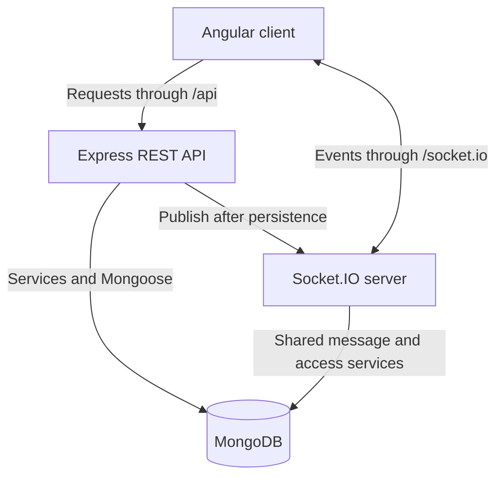

# Parley

Parley is a full-stack, real-time chat application built with Angular, Express,
Socket.IO, and MongoDB. It combines direct and group conversations with persistent
message history, unread counts, cookie-based sessions, and a responsive
light/dark interface.

[Client guide](client/README.md) · [Server and API guide](Server/README.md) ·
[Frontend architecture](client/ARCHITECTURE.md)

## Contents

- [Features](#features)
- [Technology](#technology)
- [Architecture](#architecture)
- [Repository layout](#repository-layout)
- [Getting started](#getting-started)
- [Using the application](#using-the-application)
- [Configuration](#configuration)
- [Development and checks](#development-and-checks)
- [Deployment](#deployment)
- [Security and limitations](#security-and-limitations)
- [Contributing](#contributing)
- [Licensing and credits](#licensing-and-credits)

## Features

### Accounts and identity

- Register with a unique username, email address, and primary phone number.
- Select a country by name, flag, and dialing code, then enter a local number.
  The client converts it to international format before submission.
- Sign in with a username and password; restore the session after a page reload.
- Complete required phone setup for legacy accounts before accessing chat.
- Identify people through permanent account-ID-derived avatar and username colors.
  Changing a username does not change the assigned color.

### Conversations and messages

- Start direct chats or named groups using exact usernames, emails, or primary
  phone numbers, without manually entering account IDs.
- Reuse the existing direct conversation for the same pair of accounts.
- Add and remove group members with owner/admin permission checks.
- Exchange persisted text messages, with a 10,000-character limit and multiline input.
- Read a chronological transcript with date separators and consecutive messages
  grouped under one sender header.
- Restore unread badges and the latest message preview after logout or reload,
  including messages received while offline.

### Real-time behavior and interface

- Receive live messages, typing indicators, and membership updates through Socket.IO.
- Refresh history on reconnect and reconcile duplicate message deliveries by ID.
- Synchronize private read progress across the account's connected tabs/devices.
- Search the conversation list by its displayed names.
- Switch between responsive desktop/mobile layouts and light/dark themes.
- Remember theme selection in the browser, with system preference as the default.
- Use keyboard-accessible dialogs and Enter-to-send without losing composer focus.

Phone setup is **not SMS ownership verification**. Read progress is private to
the reader; the application does not expose sender-facing “seen” receipts.

## Technology

| Layer               | Stack                                                          |
| ------------------- | -------------------------------------------------------------- |
| Frontend            | Angular 22, TypeScript 6, standalone components, signals, RxJS |
| HTTP API            | Node.js ES modules and Express 5                               |
| Real-time transport | Socket.IO 4 and `socket.io-client`                             |
| Persistence         | MongoDB with Mongoose 9                                        |
| Phone input         | `libphonenumber-js`, country-aware national-number parsing     |
| Frontend tests      | Angular test builder, Vitest, jsdom                            |
| Backend tests       | Jest, Babel Jest, HTTP and Socket.IO test helpers              |
| Package management  | npm for `client/`; pnpm for `Server/`                          |

## Architecture



The HTTP API and Socket.IO share one Node.js HTTP server and the same
MongoDB-backed session identity. The browser sends an HTTP-only session cookie;
it does not store an authentication token in local storage.

The Angular client sends messages through **REST only**. After a successful
database write, the server broadcasts the persisted message through Socket.IO.
History, send responses, and live events are merged by message ID so the same
message is rendered once.

Read progress is stored on room memberships as a timestamp/message-ID cursor.
The server derives unread counts and latest-message previews from persisted
data. Offline socket events are not queued: reconnect recovery uses room summaries
and history instead.

The frontend separates session/HTTP/theme services, application pages, chat state
and components, and shared controls/utilities. Its current screen flow uses one
application URL rather than separate routes for each authentication state.

## Repository layout

```text
Parley/
├── client/                 Angular application, tests, and static build
│   ├── src/app/core/       Session, HTTP, theme, and account contracts
│   ├── src/app/pages/      Authentication, phone setup, chat workspace
│   ├── src/app/features/   Chat state, endpoint adapter, components, utilities
│   └── src/app/shared/     Reusable controls, styles, and utilities
├── Server/                 Express and Socket.IO application
│   ├── src/controllers/   HTTP request/response handling
│   ├── src/services/      Accounts, conversations, messages, read state
│   ├── src/models/        MongoDB schemas and indexes
│   ├── src/middleware/    Session and required-phone guards
│   ├── src/sockets/       Socket authentication, handlers, and publishing
│   └── test/              Backend test suites and transport helpers
├── shared/                 Account-color implementation used by both projects
└── .gitlab-ci.yml          SAST and secret-detection template configuration
```

Directory names are case-sensitive: the backend directory is `Server`, and the
frontend directory is `client`. They have separate manifests and lockfiles;
there is no root package-install or application-start command.

## Getting started

### Prerequisites

- **Node.js 26 recommended** for a consistent runtime across both projects.
  See the [client requirements](client/README.md#requirements) for Angular's
  supported Node ranges.
- **npm 11.20.0** and **pnpm 12.8.1**, as declared in the project manifests.
- A running **MongoDB** instance reachable at `localhost:27017`.
- A checkout containing `client/`, `Server/`, and `shared/` from the same revision.

The default database is `mongodb://localhost:27017/Parley`. Set `MONGODB_URI`
in `Server/.env` to use another database, authenticated connection, or Atlas.

### 1. Install and configure the backend

From the repository root:

```sh
cd Server
pnpm install --frozen-lockfile
```

In `Server/`, copy the configuration template:

```sh
cp .env.example .env
```

Edit `.env` for your database and deployment. Never commit credentials.

Start the server from `Server/`:

```sh
pnpm dev
```

MongoDB must be available before startup. The server connects to the database,
attaches Socket.IO, and listens on port `3000`.

### 2. Install and run the frontend

In a second terminal, from the repository root:

```sh
cd client
npm ci --include=dev
cp .env.example .env
npm start
```

Open **http://localhost:4200**.

The development proxy forwards `/api` and `/socket.io` to `localhost:3000`.
Seeing port `4200` in browser network requests is expected: forwarding occurs
inside the development server.

Use `localhost` consistently. Opening the UI on `127.0.0.1` while the allowed
client origin is `http://localhost:4200` prevents socket handshakes.

## Using the application

1. Create two accounts in separate browser profiles or use a private window.
   Give each account a different primary phone number.
2. Select the phone's country and enter the national number. For example,
   select United States (`+1`) and enter `2025550123`.
3. Choose **Start a conversation** and enter the other person's exact username,
   email, or international primary phone number.
4. For a group, supply a non-blank name. Separate people with commas or new lines;
   the creator is included automatically.
5. Exchange messages. Use **Enter** to send or **Shift + Enter** for a new line.
6. Open conversation details to view members or, as an owner/admin, manage them.
7. Use the sun/moon control to switch themes. The browser remembers the choice.

Legacy accounts without a valid primary phone number can sign in, but must
complete the phone-setup screen before opening chat. Signing out remains
available during setup.

## Configuration

| File                                                         | Settings                                             | Defaults                                                  |
| ------------------------------------------------------------ | ---------------------------------------------------- | --------------------------------------------------------- |
| [`Server/.env.example`](Server/.env.example) → `Server/.env` | `NODE_ENV`, `HOST`, `PORT`, `CLIENT_URL`             | `development`, `0.0.0.0`, `3000`, `http://localhost:4200` |
| Same backend file                                            | `MONGODB_URI`, `MONGODB_SERVER_SELECTION_TIMEOUT_MS` | `mongodb://localhost:27017/Parley`, `2000` ms             |
| Same backend file                                            | `SESSION_TTL_HOURS`                                  | `24` hours for new sessions                               |
| [`client/.env.example`](client/.env.example) → `client/.env` | `DEV_HOST`, `DEV_PORT`                               | `localhost`, `4200`                                       |
| Same client file                                             | `API_PROXY_TARGET`, `API_PROXY_VERIFY_TLS`           | `http://localhost:3000`, `true`                           |

Copy each template only if the corresponding `.env` does not already exist.
Both loaders resolve their project's `.env` independently of the working
directory. Existing process environment variables take precedence. Restart the
affected process after changes; `.env` files are not hot-reloaded.

Changing backend `PORT` requires updating client `API_PROXY_TARGET`. Changing
the frontend origin requires updating server `CLIENT_URL`. For example:

```dotenv
# Server/.env
PORT=3100
CLIENT_URL=http://localhost:4300
```

```dotenv
# client/.env
DEV_PORT=4300
API_PROXY_TARGET=http://localhost:3100
```

Keep database credentials and other secrets **only on the server**. Client
environment settings configure local Node tooling, not browser runtime values;
the static production build still uses same-origin `/api` and `/socket.io`.
Production ports and routing belong to the web host/reverse proxy.
Do not commit `.env` files or deployment credentials. See the
[backend settings](Server/README.md#configuration) and
[client settings](client/README.md#configuration) for validation and security details.

## Development and checks

Run each command from the directory shown:

| Directory | Command                     | Purpose                                                                |
| --------- | --------------------------- | ---------------------------------------------------------------------- |
| `Server/` | `pnpm dev`                  | Backend with automatic restart                                         |
| `Server/` | `pnpm test`                 | Jest suites with mocked database operations                            |
| `Server/` | `pnpm test:integration`     | Real HTTP/Engine.IO transport tests; database operations remain mocked |
| `Server/` | `pnpm lint`                 | ESLint checks                                                          |
| `client/` | `npm start`                 | Angular development server and API/socket proxy                        |
| `client/` | `npm test -- --watch=false` | One-shot frontend test run                                             |
| `client/` | `npm run build`             | Production static build                                                |

Tests are not a substitute for a smoke test against a real MongoDB instance.
The GitLab CI file currently includes SAST and secret-detection templates; it
does not configure the application test commands or deployment jobs.

## Deployment

Build the client with `npm run build` from `client/`. Deploy the files in
`client/dist/client/browser/` to a static host or reverse proxy with an
`index.html` fallback.

Run the backend from `Server/` using `node src/server.js`, with:

- `NODE_ENV=production`;
- `PORT` set to its listening port;
- `CLIENT_URL` set to the exact public frontend origin;
- MongoDB configured and reachable;
- the sibling `shared/` directory present at its expected relative path.

Serve the public application over HTTPS. Production uses a secure
`__Host-session` cookie. Forward `/api` and `/socket.io` to the backend, including
WebSocket upgrades. Angular's development proxy is **not** included in the
production static build.

See the [server deployment checklist](Server/README.md#deployment-and-operations)
and [client deployment guide](client/README.md#production-deployment) before
publishing a deployment.

## Security and limitations

The repository implements session, phone-setup, membership, and group-management
guards, but it is **not a hardened production deployment**.

- Password hashing currently uses **unsalted SHA-256**. Replace it with a
  slow, salted password KDF such as Argon2, scrypt, or bcrypt before public use.
- Phone setup validates format and uniqueness, not ownership. There is no SMS
  verification, password recovery, or email-verification workflow.
- Messages are not end-to-end encrypted.
- There is no application rate limiter or dedicated CSRF-token mechanism.
- Socket subscriptions/session revocation assume a single server process and
  the default in-memory adapter; horizontal scaling requires coordination.
- History is returned in full, without pagination. Automatic message-send
  retries/idempotency are not implemented.
- Attachments, message editing/deletion, presence, public read receipts, and
  partial contact search are not implemented.
- Health/readiness endpoints and scheduled expired-session cleanup are not provided.

The [server guide](Server/README.md#security-and-current-limitations) describes
these boundaries and operational requirements in more detail.

## Contributing

1. Keep changes within the owning layer: shared controls should not depend on chat
   state, and controllers should delegate domain work to services.
2. Add or update tests beside the behavior being changed.
3. Run the relevant test, lint, and build commands.
4. Update the appropriate README when configuration, contracts, or user-visible
   behavior changes.
5. Keep credentials, generated builds, local database files, and dependency
   directories out of commits.

## Licensing and credits

`Server/package.json` declares ISC licensing. This repository does not currently
include a root `LICENSE` file or a client package license declaration; confirm
repository-wide licensing before redistribution.

Frontend design-process and icon credits are recorded in
[client/UI_DESIGN.md](client/UI_DESIGN.md) and
[client/public/icons.svg](client/public/icons.svg). Third-party dependencies
retain their respective licenses.
